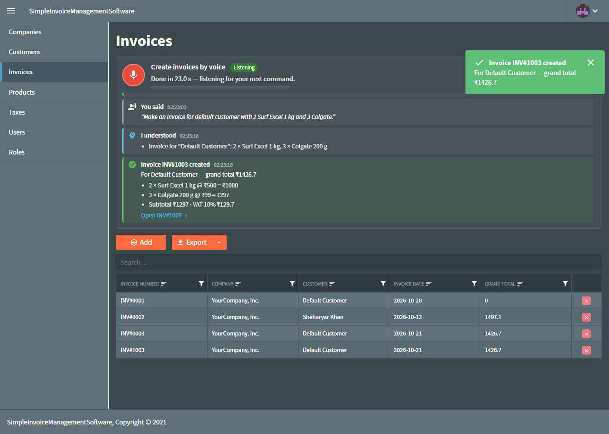
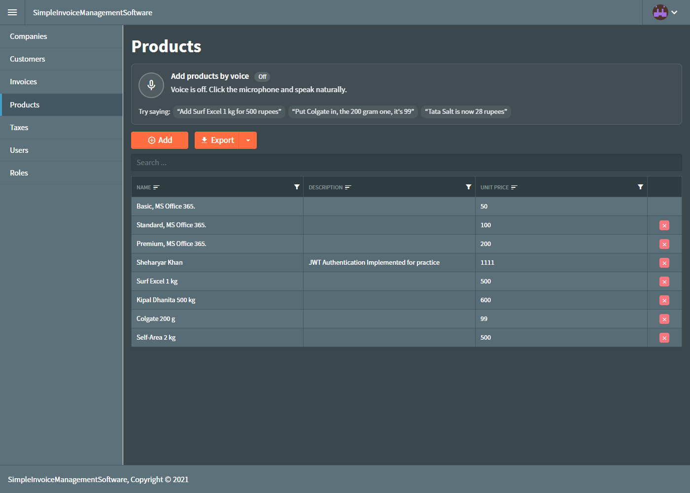

# Blazor Invoice Manager with Voice Assistant

An invoice management app (Blazor Server, .NET 8) where you can **create invoices, add products and add customers by speaking**.

Speech is turned into text by **Whisper** and understood by a **local AI model (Qwen3 via Ollama)**. Everything runs on your own machine: no paid APIs, no cloud, and no audio leaves your PC.




## Features

- Invoices, customers, products, companies and taxes, with roles-based login
- Invoice PDF print-out (RDLC)
- **Voice assistant** on three screens. Each screen does its own job:

| Screen | What you can say |
|---|---|
| **Invoices** | "Make an invoice for Ali Traders with 2 Surf Excel and 5 Tata Salt" |
| **Products** | "Add Surf Excel 1 kg for 500 rupees", "Put Colgate in, the 200 gram one, it's 99", "Tata Salt is now 28 rupees" |
| **Customers** | "New customer Ali Traders, Mall Road, Lahore" |

- Speak naturally: different wordings, Hinglish ("Maggi add kar do, 12 rupees ka packet"), several items in one sentence
- Live feedback for every step: what it heard, what it understood, spelling it fixed ("Surfix Cell" → "Surf Excel"), what it saved, and a tip when something is missing
- Nothing is saved blindly: names are matched against your database, an invoice is only created when every product is found, and duplicates are refused



## How the voice assistant works

```
Microphone (browser)
   │  16 kHz audio, split into phrases when you pause
   ▼
Whisper.net  (speech → text, runs inside the app)
   │  "Add Surfix Cell 1 kg for 500 rupees"
   ▼
Ollama + qwen3:4b  (text → JSON actions, runs locally)
   │  [{ "type": "add_product", "name": "Surf Excel", "size": "1 kg", "price": 500 }]
   ▼
VoiceCommandExecutor  (checks names against the database, then saves)
```

## Requirements

| What | Version / size | Notes |
|---|---|---|
| [.NET 8 SDK](https://dotnet.microsoft.com/download/dotnet/8.0) | 8.0 | Newer SDKs (9, 10) also build it |
| SQL Server | LocalDB, Express or full | LocalDB comes with Visual Studio |
| [Ollama](https://ollama.com/download) | any recent | Runs the local AI model |
| Browser | Chrome or Edge | Needed for the microphone |
| RAM | 8 GB minimum, 16 GB recommended | Whisper ~1 GB + AI model ~3-4 GB |
| Disk | ~4 GB free | AI model 2.5 GB + Whisper model 0.5 GB |

Tested on Windows 11 with an Intel Core Ultra 7 (CPU only, no GPU needed).

## Setup

### 1. Clone

```bash
git clone https://github.com/sheharyarkhan0003/blazor-invoice-voice-assistant.git
cd blazor-invoice-voice-assistant
```

### 2. Database

The app creates the database `SimpleInvoice` and some demo data **automatically on first run**. You only need a SQL Server instance.

The default connection string in [`server/appsettings.json`](server/appsettings.json) uses **LocalDB** with Windows authentication:

```json
"SimpleInvoiceConnection": "Server=(localdb)\\MSSQLLocalDB;Initial Catalog=SimpleInvoice;Integrated Security=true;..."
```

- **LocalDB:** check that it exists with `sqllocaldb info`. If not, install it with Visual Studio or the [SQL Server Express installer](https://www.microsoft.com/sql-server/sql-server-downloads) (choose "LocalDB").
- **SQL Server Express:** change `Server=(localdb)\\MSSQLLocalDB` to `Server=.\\SQLEXPRESS`.
- **Other server:** put your own connection string there.

### 3. Ollama and the AI model

1. Install Ollama from [ollama.com/download](https://ollama.com/download) (on Windows: `winget install Ollama.Ollama`).
2. Start it (Windows: "Ollama" in the Start menu). It runs at `http://localhost:11434`.
3. Download the model (2.5 GB):

   ```bash
   ollama pull qwen3:4b
   ```

   If you skip this, the app downloads the model the first time you click the microphone.

### 4. Run

```bash
cd server
dotnet run
```

Open **http://localhost:5000** and log in:

- Username: `administrator`
- Password: `123456`

### 5. First voice command

1. Open **Products**, **Customers** or **Invoices**.
2. Click the round **microphone** button and allow microphone access in the browser.
3. The first time, the Whisper speech model (~490 MB) downloads into `server/WhisperModels/`. After that, voice starts in a few seconds.
4. Speak, then pause for about a second. Watch the activity list for what it heard and did.

A command takes about 10-20 seconds on a laptop CPU (speech-to-text plus the AI). A GPU makes it faster.

## Configuration

All settings are in [`server/appsettings.json`](server/appsettings.json).

| Setting | Default | What it does |
|---|---|---|
| `ConnectionStrings:SimpleInvoiceConnection` | LocalDB | Database connection |
| `CustomSettings:UserAdministrator` | administrator / 123456 | Admin account created on first run |
| `Whisper:ModelType` | `SmallEn` | Speech model size: `BaseEn` (150 MB, faster, less accurate), `SmallEn` (490 MB), `MediumEn` (1.5 GB, slowest, most accurate) |
| `Whisper:ModelFolder` | `WhisperModels` | Where speech models are stored |
| `Whisper:Prompt` | list of brands | Brand names that help Whisper spell them right. **Add the brands you sell.** |
| `Ai:BaseUrl` | `http://localhost:11434` | Ollama address |
| `Ai:Model` | `qwen3:4b` | Any Ollama model. Bigger (`qwen3:8b`) = smarter but slower; smaller (`qwen3:1.7b`) = faster but makes more mistakes |

Your existing product and customer names are also given to Whisper and the AI automatically, so they are recognised better.

## Troubleshooting

| Problem | Fix |
|---|---|
| "Ollama is not running" | Start Ollama from the Start menu and wait about a minute. Check http://localhost:11434 shows "Ollama is running". |
| Microphone does not start | Allow the microphone (icon in the address bar). Browsers only allow the mic on `localhost` or over **HTTPS**. |
| Wrong words heard | Speak closer to the mic. Use `Whisper:ModelType` = `SmallEn` or `MediumEn`. Add your brand names to `Whisper:Prompt`. |
| Very slow | Normal on CPU: about 10-20 s per command. Close heavy apps (the AI needs ~4 GB free RAM) or try `qwen3:1.7b`. |
| Cannot connect to the database | Check the connection string, and that LocalDB/SQL Server is running (`sqllocaldb start MSSQLLocalDB`). |
| Model download is slow or stuck | The first run downloads ~3 GB in total (AI + speech). You can download the AI model in advance with `ollama pull qwen3:4b`. |

## Project structure

```
server/                         Blazor Server app (main project)
  Services/
    SpeechToTextService.cs      Whisper.net speech-to-text, downloads the model on first use
    LocalAiService.cs           Talks to Ollama; instructions, examples and JSON schema for the AI
    VoiceCommandExecutor.cs     Checks AI actions against the database and saves them
  Shared/
    VoiceAssistant.razor(.cs)   The voice panel used on Invoices, Products and Customers
  wwwroot/js/voice-commands.js  Microphone capture, silence detection, level meter
  wwwroot/css/voice-assistant.css
  Pages/                        Invoices, Products, Customers, ... (generated by Radzen IDE)
Entity/                         Entity classes (.NET Standard 2.0)
RDLC/                           WinForms helper used to design the invoice report (not needed to run)
meta/                           Radzen IDE metadata
```

## Changes from the original project

- `System.Linq.Dynamic.Core` pinned to 1.6.x. The version that comes with Radzen 3.2.6 crashes on .NET 6+ ("No interop methods are registered for renderer").
- Radzen.Blazor kept at 3.2.6 on purpose (newer versions change the UI components)
- Voice assistant added (see above)
- Default database changed to LocalDB

## Security notes

- **Change the admin password** before putting the app anywhere other than your own PC.
- Never expose Ollama (port 11434) to the internet.
- To use the microphone from other devices, serve the app over HTTPS.

## Credits and license

- [Radzen Blazor Components](https://github.com/radzenhq/radzen-blazor) (MIT)
- [Whisper.net](https://github.com/sandrohanea/whisper.net) and [whisper.cpp](https://github.com/ggerganov/whisper.cpp) (MIT); Whisper models by OpenAI (MIT)
- [Ollama](https://github.com/ollama/ollama) (MIT); [Qwen3](https://github.com/QwenLM/Qwen3) model (Apache 2.0)
